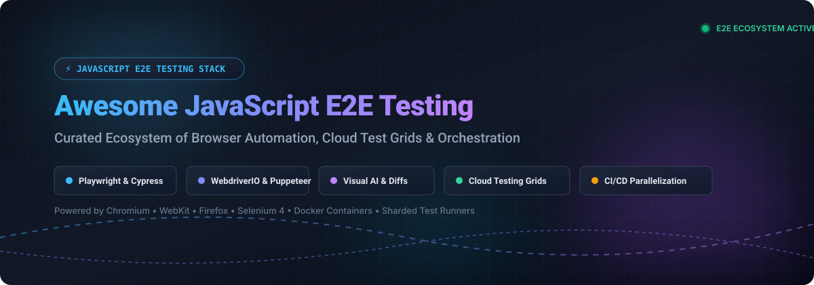

# 🚀 Awesome JavaScript End-To-End (E2E) Testing & Automation Integration

  
  
  
  
  
  

  <strong>Curated Directory of Modern JavaScript & TypeScript End-to-End (E2E) Testing Frameworks, Cloud Browser Grids, AI Test Automation, Visual Regression &amp; CI/CD Orchestration</strong>

---

## 📖 Table of Contents

- [🌐 Sector Overview & Market Dynamics](#-sector-overview--market-dynamics)
- [☁️ SaaS & Hosted Cloud Testing Platforms](#️-saas--hosted-cloud-testing-platforms)
- [⚡ Open-Source GitHub Projects (Sorted by Stars)](#-open-source-github-projects-sorted-by-stars)
  - [🏆 Core Frameworks & Runners](#-core-frameworks--runners)
  - [🛠️ Network Mocking, Accessibility & Performance Testing](#️-network-mocking-accessibility--performance-testing)
  - [🖥️ Cloud Grids, Docker Runners & Test Dashboards](#️-cloud-grids-docker-runners--test-dashboards)
  - [👁️ Visual Regression & Specialized E2E Engines](#️-visual-regression--specialized-e2e-engines)
- [📈 Star History](#-star-history)
- [💖 Support & Sponsorship](#-support--sponsorship)
- [🤝 How to Contribute](#-how-to-contribute)
- [⚖️ Disclaimer & Security Best Practices](#️-disclaimer--security-best-practices)

---

## 🌐 Sector Overview & Market Dynamics

The global automated and continuous testing market is valued at approximately **$40 billion** (with dedicated CI/CD continuous testing tools comprising $2.5B–$2.7B) and is compounding at **~14–16% CAGR** driven by shift-left testing, microservices, and AI-assisted QA workflows. 

The sector exhibits a **moderately fragmented** structure: legacy test management and enterprise compliance remain concentrated around a handful of dominant vendors, while modern cloud execution, browser grids, and visual regression layers remain highly competitive and fragmented with intense startup innovation and open-source disruption.

---

## ☁️ SaaS & Hosted Cloud Testing Platforms

| Platform | Description | Pricing (Starting Tier) | Free Tier / Trial Limits | Company Size (Valuation / Revenue) |
|---|---|---|---|---|
| **[Microsoft Playwright Workspaces (Azure App Testing)](https://azure.microsoft.com/products/playwright-testing)** | Managed cloud-hosted browser infrastructure enabling Playwright test suites to run at massive cloud scale. | $0.01 / browser minute (Linux); $0.02 / browser minute (Windows) pay-as-you-go | 30-day free trial with 100 free browser minutes (1 workspace per Azure subscription) | $3.1+ Trillion Market Cap / $245B+ Annual Revenue |
| **[BrowserStack Automate](https://browserstack.com/automate)** | Real-device & browser cloud testing grid featuring native SDK integrations for Playwright, Cypress, WebdriverIO, and Nightwatch.js. | $59/month (Chrome Desktop) or $99/month (All Desktops, billed annually) per parallel test | 60 automated testing minutes (no credit card required; unlimited team members) | $4 Billion Valuation / ~$200M–$225M ARR |
| **[Percy (by BrowserStack)](https://percy.io)** | Automated visual testing & review platform integrating into Playwright, Cypress, WebdriverIO, and Puppeteer to catch UI regressions. | $199/month (Desktop plan, billed annually) for 10,000 screenshots/month | Free forever: 5,000 web screenshots/month (unlimited users & projects) | Parent: $4 Billion Valuation (BrowserStack) |
| **[Sauce Labs Cross-Browser Cloud](https://saucelabs.com)** | Enterprise continuous testing cloud supporting JavaScript E2E frameworks across thousands of browser/OS combinations. | $39/month (Live testing) or $149/month (Virtual Device Cloud, billed annually) | 28-day free trial: 60 automated/live testing minutes, 3 parallel VMs, 50 AI queries | $613 Million Valuation / ~$66M–$100M ARR |
| **[LambdaTest HyperExecute & Cloud Grid](https://lambdatest.com)** | AI-orchestrated cloud execution grid providing high-speed parallel runs for Cypress, Playwright, Puppeteer, and WebdriverIO. | $79/month (Web Automation, billed annually) per parallel test | Free forever: 100 lifetime automated testing minutes (2 parallel sessions) & 60 live minutes/month | $400 Million Valuation / ~$20M–$120M Revenue |
| **[Applitools Eyes](https://applitools.com)** | Visual AI testing & monitoring engine offering SDKs for every major JavaScript E2E and component testing framework. | $667/month (Starter tier, billed annually) | 14-day free trial: 50 test units / limited checkpoints | $250M–$500M Acquisition Valuation / ~$25M–$30M ARR |
| **[Cypress Cloud](https://cypress.io)** | Managed test orchestration and analytics platform providing smart parallelization, flake detection, and Test Replay for Cypress suites. | $67/month ($799/year billed annually for Team plan; 120,000 test results/year) | Free forever: 500 test results/month, up to 10 users, 30-day data retention | $255 Million Valuation / ~$15M–$18M ARR |
| **[TestCafe Studio (DevExpress)](https://www.devexpress.com/products/testcafestudio/)** | Commercial visual test recorder and IDE built on the TestCafe engine for codeless and code-hybrid JavaScript E2E tests. | $244.99/year per tester license (annual subscription) | 30-day fully functional free trial (no license key required during trial) | Bootstrapped; ~$44M–$50M Annual Revenue |
| **[Rainforest QA](https://www.rainforestqa.com)** | AI-driven and crowd-assisted functional testing platform enabling natural-language and no-code authoring alongside CI/CD pipelines. | $200/month (Pay-As-You-Go base + $5/hr automated testing) | Free forever (Essentials): 5 hours of automated testing/month | ~$42M Total Raised / ~$25M ARR |
| **[Momentic](https://momentic.ai)** | AI-native end-to-end testing platform enabling natural-language test authoring, self-healing, and JavaScript CI/CD integration. | $500/month (Scale plan) | Free forever: $50 worth of monthly usage credits (approx. 2,000 credits, no credit card required) | ~$22.8M Total Raised (Series A) |
| **[Currents.dev](https://currents.dev)** | Cloud orchestration dashboard for Playwright, Cypress, and Jest with parallelization, flake analytics, and CI/CD reporting. | $49/month (Scale plan for 10,000 test results/month) | 14-day free trial: up to 10,000 test results (no credit card required) | Early-stage private / ~$440K ARR |

---

## ⚡ Open-Source GitHub Projects (Sorted by Stars)

All open-source tools below are strictly sorted in descending order of GitHub stargazers. Each repository Stars_Badge links directly to that repository's stargazers community page.

### 🏆 Core Frameworks & Runners

1. **[Playwright](https://github.com/microsoft/playwright)**   
   Modern, ultra-fast end-to-end testing and browser automation framework by Microsoft supporting Chromium, Firefox, and WebKit with auto-waiting, network interception, trace viewer, and codegen.

2. **[Puppeteer](https://github.com/puppeteer/puppeteer)**   
   Official Node.js library developed by the Chrome DevTools team providing a high-level API to automate Chrome and Firefox over the Chrome DevTools Protocol (CDP) and WebDriver BiDi.

3. **[Cypress](https://github.com/cypress-io/cypress)**   
   Developer-friendly JavaScript & TypeScript E2E and component testing framework executing directly inside the browser with time-travel debugging, automated waiting, and screenshot/video capture.

4. **[Jest](https://github.com/jestjs/jest)**   
   Widely adopted JavaScript testing framework by Meta frequently paired with Puppeteer (`jest-puppeteer`), Playwright, and DOM environments for end-to-end integration and smoke suites.

5. **[Selenium](https://github.com/SeleniumHQ/selenium)**   
   The foundational browser automation standard (`selenium-webdriver`), powering cross-browser execution across Chrome, Firefox, Safari, and distributed Selenium Grid 4 nodes.

6. **[Mocha](https://github.com/mochajs/mocha)**   
   Simple, flexible JavaScript test framework running on Node.js and in the browser, providing asynchronous testing, custom reporters, and pairing with WebDriver or Puppeteer.

7. **[AVA](https://github.com/avajs/ava)**   
   Futuristic, minimal test runner for Node.js executing tests concurrently in separate processes, ideal for fast, isolated JavaScript integration and browser script executions.

8. **[Vitest](https://github.com/vitest-dev/vitest)**   
   Next-generation Vite-native testing framework with native ESM support and an interactive Browser Mode powered by Playwright and WebdriverIO for authentic browser rendering.

9. **[Jasmine](https://github.com/jasmine/jasmine)**   
   Clean Behavior-Driven Development (BDD) testing framework for JavaScript with zero external dependencies, historically foundational for browser-level assertions.

10. **[Nightwatch.js](https://github.com/nightwatchjs/nightwatch)**   
    Integrated Node.js end-to-end testing solution featuring built-in test runners, native W3C WebDriver client, and direct cloud integration with BrowserStack and Sauce Labs.

11. **[TestCafe](https://github.com/DevExpress/testcafe)**   
    Zero-WebDriver Node.js end-to-end testing tool that injects scripts into web pages via a reverse-proxy URL rewriting mechanism for hassle-free cross-browser automation.

12. **[WebdriverIO](https://github.com/webdriverio/webdriverio)**   
    Next-gen extensible browser and mobile automation framework for Node.js supporting both W3C WebDriver and Chrome DevTools Protocol with an extensive plugin ecosystem.

13. **[Cucumber.js](https://github.com/cucumber/cucumber-js)**   
    The official JavaScript implementation of Cucumber, enabling teams to execute executable Gherkin plain-text specifications backed by Playwright, Cypress, or WebdriverIO.

14. **[CodeceptJS](https://github.com/codeceptjs/CodeceptJS)**   
    Modern scenario-driven BDD testing framework providing high-level human-readable actor APIs on top of underlying helpers like Playwright, WebdriverIO, and Puppeteer.

15. **[Taiko](https://github.com/getgauge/taiko)**   
    Free and open-source Node.js library with a smart selector engine and interactive REPL designed by ThoughtWorks for readable and reliable browser automation.

---

### 🛠️ Network Mocking, Accessibility & Performance Testing

16. **[k6 Browser (`grafana/k6`)](https://github.com/grafana/k6)**   
    Modern load and performance testing tool featuring a native browser module to run real browser automation scripts alongside backend protocol-level stress tests.

17. **[Mock Service Worker (`msw`)](https://github.com/mswjs/msw)**   
    Seamless API mocking tool using Service Workers to intercept and stub REST and GraphQL network requests transparently across Playwright, Cypress, and browser tests.

18. **[Artillery](https://github.com/artilleryio/artillery)**   
    Cloud-native load and functional testing platform featuring Playwright engine integration to test critical user journeys under intense simulated traffic.

19. **[Axe-core Accessibility Engine](https://github.com/dequelabs/axe-core)**   
    The industry-standard accessibility testing engine for HTML, integrating directly into E2E pipelines via `@axe-core/playwright` and `cypress-axe` to enforce WCAG compliance.

20. **[DOM Testing Library](https://github.com/testing-library/dom-testing-library)**   
    Simple and complete testing utilities that encourage accessible user-centric querying patterns, extended via `playwright-testing-library` and `cypress-testing-library`.

---

### 🖥️ Cloud Grids, Docker Runners & Test Dashboards

21. **[Allure Report](https://github.com/allure-framework/allure2)**   
    Multi-language, lightweight test report tool producing visual HTML reports with interactive timelines, flaky test charts, screenshots, and step execution details for Playwright and Cypress.

22. **[Sorry Cypress](https://github.com/sorry-cypress/sorry-cypress)**   
    Open-source, self-hosted on-premise alternative to Cypress Cloud offering automatic test parallelization, artifact storage (S3/MinIO), and execution dashboard.

23. **[Selenoid](https://github.com/aerokube/selenoid)**   
    Blazing-fast Golang implementation of the Selenium Hub that spins up isolated browser sessions inside lightweight Docker containers on demand with live VNC and video streaming.

24. **[ReportPortal](https://github.com/reportportal/reportportal)**   
    AI-powered test automation analytics server providing real-time log aggregation, intelligent failure clustering, and deep test health metrics across automated CI suites.

25. **[Moon (Aerokube)](https://github.com/aerokube/moon)**   
    Kubernetes-native browser execution grid scaling Playwright, Puppeteer, and Selenium instances inside pods on demand.

---

### 👁️ Visual Regression & Specialized E2E Engines

26. **[BackstopJS](https://github.com/garris/BackstopJS)**   
    Configurable visual regression testing tool catching CSS and layout breakages across responsive viewports via Puppeteer and Playwright.

27. **[Loki](https://github.com/oblador/loki)**   
    Visual regression testing framework built for Storybook powered by headless Chrome, Docker, or AWS Lambda for fast UI component diffing.

28. **[Lost Pixel](https://github.com/lost-pixel/lost-pixel)**   
    Modern holistic visual regression testing engine integrating seamlessly with Storybook, Ladle, Next.js, and Playwright for end-to-end visual validation.

29. **[Synpress](https://github.com/synpress/synpress)**   
    E2E testing framework tailored for Web3 decentralized applications (dApps), providing Playwright & Cypress wrappers with built-in MetaMask and crypto wallet automation.

---

## 📈 Star History

---

## 💖 Support & Sponsorship

Thank you so much for exploring and using this curated resource! If you find this repository valuable for your engineering team, QA pipelines, or open-source research, please consider supporting the project:

- ⭐ **Star this repository** to help others discover it across GitHub.
- 🍴 **Fork and share** it with fellow automation engineers, SDETs, and frontend teams.
- ☕ **Buy a coffee & sponsor ongoing maintenance:**  
  👉 **[Sponsor on GitHub: ishandutta2007](https://github.com/sponsors/ishandutta2007)**

Every contribution and star fuels continuous updates to keep this ecosystem comprehensive, accurate, and up-to-date!

---

## 🤝 How to Contribute

Contributions are warmly welcome! Please review our guidelines to suggest additions or revisions:

1. 🍴 **Fork the repository** on GitHub.
2. 📝 **Add or update entries** in `README.md` maintaining the existing structure:
   - Include tool name, official link, GitHub repository (if open-source), and a concise 1–2 sentence description.
   - For SaaS products, include exact pricing, free tier/trial limits, and company size data.
   - For open-source projects, include the social-style Stars_Badge linking to its stargazers page.
3. 🚀 **Submit a Pull Request** with a clear explanation of what was added or changed.

---

## ⚖️ Disclaimer & Security Best Practices

- This repository is a **community-curated index** provided for informational and educational purposes — listings do not constitute an explicit commercial endorsement.
- **Security Best Practices**: When configuring automated end-to-end test runners, cloud grids, or CI/CD pipelines against staging/production environments:
  - Never check raw credentials, API keys, or cloud access tokens into test repositories.
  - Utilize isolated sandbox/test accounts and synthetic anonymized test datasets.
  - Apply the principle of least privilege to CI/CD runner secrets and proxy connections.
